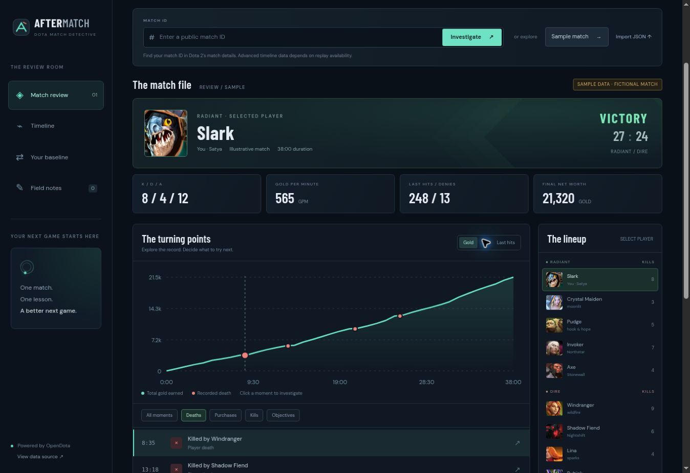

# AfterMatch

**Every match leaves clues.** A Dota 2 match review room for exploring your games, finding a recurring pattern, and saving one takeaway for the next match.



## Try it

The app opens with a clearly labeled fictional Slark match. Switch players, filter the event log, select a death or purchase, and compare gold, experience, and last hits over time.

Enter a public Dota 2 match ID to load real data from OpenDota. Match **9076476183** was used for a live-data check on 5 November 2026. Replay-derived data can become unavailable, so this ID is an example rather than a permanent fixture.

You can also import a saved OpenDota match response as JSON, up to 10 MB. JSON imports are read in the browser.

## Run locally

Requires Node.js 20 or later.

```sh
npm start
```

Open http://localhost:3000. There are no runtime npm dependencies and no API key is required for the implemented public OpenDota requests. The frontend can also be hosted by any static web server from the `dist/` directory.

```sh
npm test
```

The tests use Node’s built-in test runner.

## What works

- Coaching cards that turn recorded death patterns and role-specific lane-farm signals into a suggested action, replay drill, and next-game practice target.
- Core/Support/Unsure selection to gate lane-farm advice. Coaching begins with Unsure.
- One-click saving of a practice plan to field notes, preserving existing text and preventing duplicates.
- Match ID lookup with timeouts, cancellation, and useful network and rate-limit errors.
- Player selection across both teams, with hero portraits and summary statistics.
- Gold, XP, and last-hit charts from the player’s sampled timeline.
- Replay-analysis requests for summary-only matches, bounded polling, and a manual refresh that keeps the selected player.
- A fallback report of kill participation, hero damage, and tower damage when a timeline is unavailable.
- A filterable event log of purchases, player kills, deaths, tower kills, and Roshan kills.
- Clickable moments with the last earlier gold sample and purchases in the preceding three minutes.
- Personal baselines from up to ten other public games on the selected hero.
- One saved takeaway per match and player, with recent notes, deletion, and JSON export.
- A fictional sample match, including a clearly labeled sample comparison.
- Local JSON import, responsive layout, reduced-motion handling, keyboard navigation, and accessible event controls.

## Coaching scope

Coaching is generated by explicit rules in `dist/coach.js`. It currently checks repeated early deaths, repeated deaths credited to one opponent, Core lane-farm results below a declared practice trigger, and a recorded zero-use Black King Bar with enough post-purchase time and deaths. Missing item-use data is never treated as zero.

The initial role is Unsure. Farm prompts require the visitor to select Core. The trigger of fewer than 40 last hits at 10:00 is a product heuristic, not a rank- or matchup-adjusted standard. Practice targets use the selected player’s result as a starting point. They are experiments, not predictions.

Cards distinguish recorded facts from causes that need replay review. The app does not infer hooks, vision, positioning, cooldowns, or preventability from kill logs. It links each available death to the existing moment inspector. Saving a plan adds it to browser-local field notes. Tracking its outcome across the next three games is currently manual.

## Data and interpretation

A summary-only match does not contain minute-by-minute timelines. AfterMatch labels it Summary only, shows the available final statistics, and offers Request replay analysis. That action submits the match ID to OpenDota, checks the job and match for up to 18 rounds at five-second intervals, and loads actual replay data if it arrives. A finished job alone is not treated as a completed analysis. If data is still unavailable, manual refresh and a link to the OpenDota match page remain available. Replay retrieval is controlled by OpenDota and Valve and is not guaranteed.

Death times are never invented from a final death count. Anonymous players can have replay timelines without having the public account identity needed for historical comparisons.

Death events are reconstructed by finding the selected hero in opposing players’ `kills_log` entries. Those logs can be incomplete. A death event is an observation, not a diagnosis of what caused a loss.

The gold chart displays sampled total gold earned. It is separate from the final net-worth statistic. A selected moment uses the last sampled value at or before its timestamp.

Recent-game comparisons use the same player and hero, exclude the current match, and average available values. They can span different game lengths, roles, and patches. Public player history is required. Anonymous players can still be reviewed without a comparison.

Sample data is synthetic. All sample players and event timings are illustrative, including the baseline.

## Architecture

`dist/model.js` contains data validation, event reconstruction, series selection, comparisons, and moment context. It is independent of the DOM and covered by unit tests.

`dist/app.js` handles the interface, requests, cancellation, and browser-local notes. A new match or player selection cancels a pending baseline request. A late response cannot overwrite a newer selection.

`server.mjs` is a small local static server. Hosted operation is entirely client-side. The app has no account system or backend database.

### File layout

```text
dist/
  index.html
  styles.css
  app.js
  model.js
  coach.js
  replay.js
  mark.svg
  data/
    heroes.json
    items.json
    demo-match.json
test/
  model.test.js
  coach.test.js
  replay.test.js
server.mjs
```

## Storage and external requests

Takeaways are saved in this browser’s local storage, with a maximum of 100 entries. Clearing site data removes them. Export your notes to keep a backup. Notes do not sync between devices.

Public match and player-history requests go to the OpenDota API. Hero and item pictures load from Valve’s Steam CDN. Google Fonts supplies the interface fonts, with system-font fallbacks. Data dictionaries are bundled so opening a sample does not need a live OpenDota response.

## Next useful increments

- Compare the first ten minutes across several fully parsed matches.
- Group nearby events into reviewable fight windows, with explicit evidence.
- Add note import and an optional account-backed notebook.
- Add integration tests for loading, import, and request cancellation.

## Attribution

- [OpenDota API](https://opendota.apidocumentation.com/) for public match and player data.
- Hero and item labels are a snapshot of the OpenDota constants endpoints retrieved on 5 November 2026.
- Dota 2 and the hero/item artwork belong to Valve. AfterMatch is an independent fan project.

The original application code is released under the MIT license.
